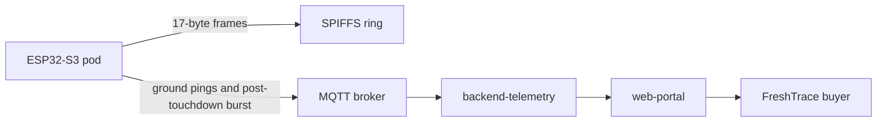

# FreshFlite™ FF-PDD-2026-V1.0

Prepared for the **Ibom Air AKTW Frontier Pitch Competition 2026** and the **InnoX OIP** technical judges.

FreshFlite is an aviation-compliant cold-chain telemetry system for Ibom Air cargo holds. It tracks coastal seafood from the Oron and Ibeno aggregation points through UYO, and onward to LOS and ABV, on the CRJ 900 and the Airbus A220-300. The design follows ICAO Annex 6 radio-silence practice and FAA AC 91.21-1D portable-electronic-device guidance.

The acceptable thermal band is **−2.00°C to +4.00°C**. The pod stores temperature as integer centi-degrees, **−200 to 400**, so 0.01°C is the source of truth. A lid breach is a light reading **above 200 lux**.

**Cloudflare Pages URL (placeholder, not yet asserted as deployed):** [https://freshflite.pages.dev](https://freshflite.pages.dev)

The Pages project name in `wrangler.toml` is `freshflite`. This repository is the source of truth until that hostname is published.

## Architecture

One packed binary contract is shared by the ESP32-S3, the Node.js ingestion service, and the browser. A frame written on the pod decodes to the same fields in every runtime.



| Package | Role |
| --- | --- |
| `packages/firmware-esp32s3` | ESP32-S3-WROOM-1 firmware. Seals 17-byte frames, keeps the in-flight ring in SPIFFS, and publishes the burst after touchdown. |
| `packages/shared-schema` | Little-endian codec, IEEE 802.3 CRC32, and the Ed25519 FreshTrace seal. No third-party signature library. |
| `packages/backend-telemetry` | MQTT ingestion, optional Timescale storage, and WhatsApp/SMS dispatch alerts. |
| `packages/web-portal` | Static portal: coastal companion, Ibom Air dispatch, and the buyer trace page. Exported for Cloudflare Pages. |

In flight the pod enters silent mode: it powers down the SIM7600, turns Wi-Fi and Bluetooth off, and appends frames to `/spiffs/flight_ringbuf.bin`. After touchdown it wakes the modem and publishes the file to `freshflite/v1/pods/FF-S3-01A/burst`. The portal stages are the coastal companion at `/companion`, dispatch at `/`, and the buyer trace for manifest `FF-MAN-QI0412-20261014`.

## 17-byte binary schema

Every MQTT payload and SPIFFS record is exactly **17 bytes**, little-endian. Burst dumps are concatenations of these frames. The CRC32 is IEEE 802.3 over bytes 0 through 12 only, stored at offset 13. The check value for ASCII `123456789` is `0xCBF43926`.

| Offset | Type | Field | Notes |
| --- | --- | --- | --- |
| 0..3 | `uint32` | `unix_timestamp` | UTC seconds |
| 4..5 | `int16` | `temperature_centi` | 0.01°C. Example: `−150` = −1.50°C |
| 6..7 | `uint16` | `humidity_centi` | 0.01% RH. Example: `8520` = 85.20% |
| 8 | `uint8` | `battery_soc_pct` | 0 to 100 |
| 9 | `uint8` | `tamper_status` | `0x00` OK, `0x01` lid breach above 200 lux, `0x02` shock, `0x03` both |
| 10 | `uint8` | `flight_state` | `0x00` ground, `0x01` in-flight silent, `0x02` post-touchdown burst |
| 11..12 | `int16` | `peak_accel_mG` | Milli-g. Example: `1320` = 1.32 g |
| 13..16 | `uint32` | `checksum_crc32` | CRC32 of bytes 0..12 |

The reference sample used by the verifiers is unix time `1760421600`, −150 centi-degrees, humidity 8520, battery 91, silent flight state, and 1320 mG. Its packed frame is `e0e6ed686aff48215b000128057e9bf01f`.

## Hardware pinout

Target board: ESP32-S3 DevKitC-1, 16 MB flash, Arduino on the ESP-IDF core. Logic is **3.3 V only**. The modem TX line goes to ESP RX on GPIO 17, and the ESP TX line goes to modem RX on GPIO 18. The modem uses its own supply and a common ground. Full bench steps are in [`packages/firmware-esp32s3/BENCH_TESTING_GUIDE.md`](packages/firmware-esp32s3/BENCH_TESTING_GUIDE.md).

| Signal | Connection | Notes |
| --- | --- | --- |
| I2C SDA | GPIO 8 | Shared by SHT31 and LIS3DH |
| I2C SCL | GPIO 9 | Shared by SHT31 and LIS3DH |
| SHT31 | `0x44` | Temperature and humidity |
| LIS3DH | `0x18` | Acceleration. INT1 on GPIO 10. SDO/SA0 held low |
| SIM7600 RX | GPIO 17 | Modem TX into the ESP |
| SIM7600 TX | GPIO 18 | ESP TX into the modem |
| SIM7600 PWRKEY | GPIO 21 | Idle high. Active-low pulse of 1500 ms |
| TEMT6000 | GPIO 4 | ADC. Sealed below 50 lux. Breach above 200 lux |

Serial monitor speed is **115200**. Bench keys: `P` one ground frame, `T` simulated 1.38 g takeoff into silent mode, `B` lid breach, `L` simulated 1.00 g landing and burst flush, `S` pinout and diagnostics. A bare DevKit with no sensors still runs in bench simulation.

## Run the verification suite and the portal

Requires Node.js 20 or newer.

```bash
npm install
npm run verify:all
npm run dev:web
```

`npm run verify:all` runs Sprints 1 through 5 in one pass: the 17-byte codec and Ed25519 seal, the dispatch registry, MQTT ingestion, the companion static export, and the ESP32-S3 header contract. `npm run dev:web` starts the portal at [http://localhost:3000](http://localhost:3000).

Firmware upload uses PlatformIO from [`packages/firmware-esp32s3/platformio.ini`](packages/firmware-esp32s3/platformio.ini). The host CRC parity check runs when `g++`, `clang++`, or `pio` is on PATH. Header checks still pass when those tools are absent.
